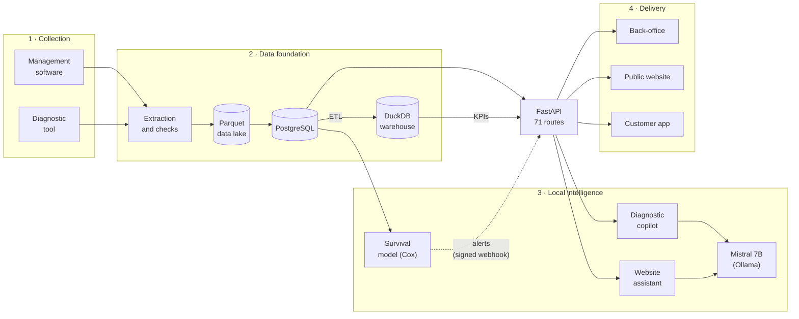
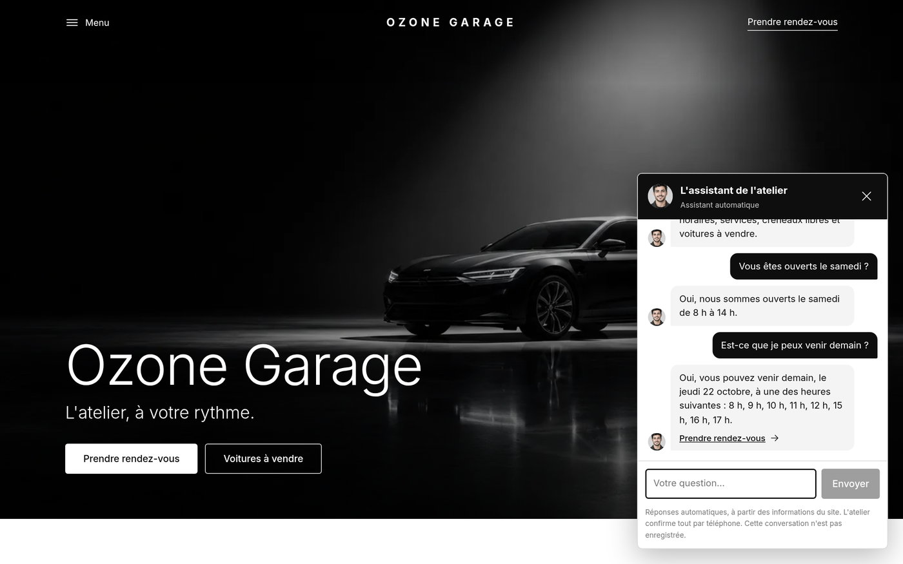
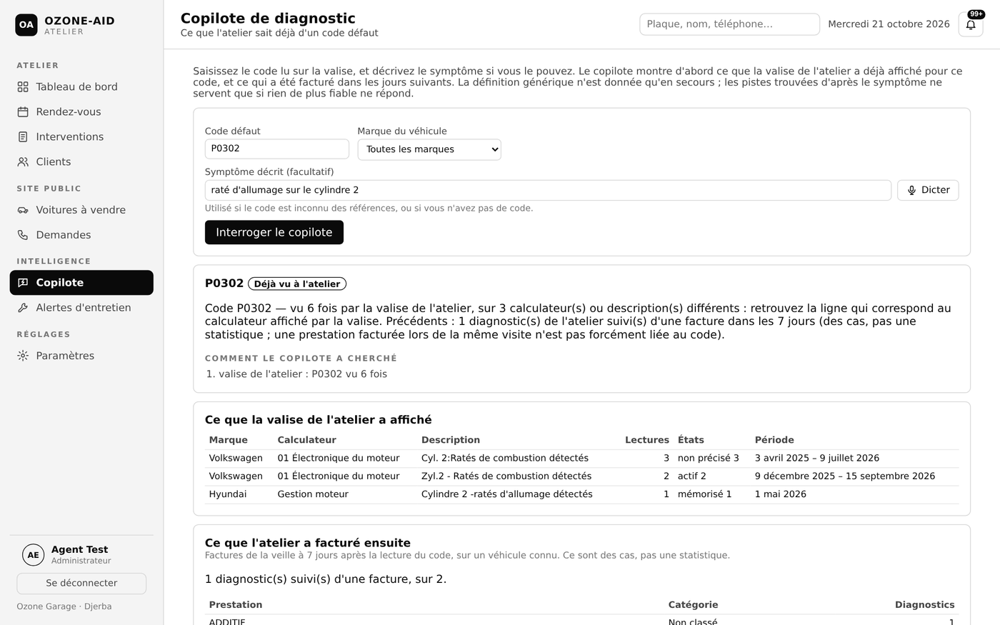
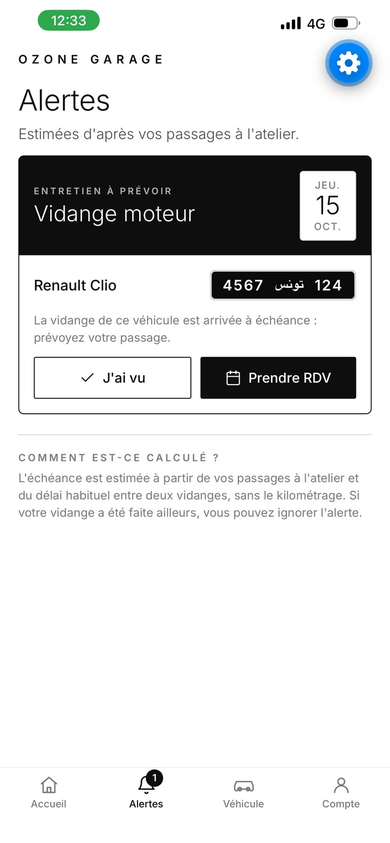

# OZONE-AID: intelligent diagnostic, management and predictive maintenance platform

> **In one sentence:** an integrated platform that turns **8 years of real history** from a car repair workshop
> into a public website, a back-office and a mobile app, with a data warehouse, a survival model and a
> diagnostic copilot, all running **locally**, so that no customer data ever leaves the workshop.

Engineering final-year project (Big Data & Business Intelligence), carried out at **Ouerkema Innovation**
for **Ozone Garage**, an auto mechanics and electrics workshop in Djerba, Tunisia.
Defended in November 2026 and graded ***Très bien*** (highest honours).

> 🔒 **The source code is private** (project delivered for a client during a company internship).
> A demo and further technical details are available on request.

---

## The problem

A workshop produces data every day without using it. Repair orders, service lines and invoices all go into
the management software, which is only used to look up old invoices. Observing the workshop revealed three
gaps:

- **Appointments were not managed**: no tool, no reminders, no record of no-shows.
- **Activity was not measured**: invoices, but no indicators to steer the business.
- **Maintenance was not anticipated**: customers came back on their own, or once the breakdown had happened.

**Research question:** how can a workshop's history become a tool for diagnosis, management and maintenance
planning, without customer data leaving the workshop, and taking into account what the data actually contains?

## The solution

**Three entry points, one core.** Each interface serves one type of user, on top of a single core (data
foundation, API, models and agent, alerts and notifications):

| Interface | For | |
|---|---|---|
| Public website (FR/EN) | visitors and customers | online booking, cars for sale, assistant |
| Back-office | workshop staff (3 roles) | appointments, repairs, customers, dashboard, copilot, maintenance alerts |
| Mobile app (React Native) | customers | maintenance alerts, booking, vehicle history |

---

## The data: real, and incomplete

Exports from the management software (2018–2026) and from the diagnostic tool:
**8,858 repair orders, 28,546 service lines, 4,581 vehicles, 1,446 customers, 291 diagnostic reports**,
extracted locally from PDFs, validated, with doubtful rows quarantined.

What the data does **not** contain shaped the whole project: no recorded symptoms, a known make for only
42 % of vehicles, and no phone number for four customers out of five.

---

## Architecture

The data foundation is a **replayable pipeline launched by a single script**: it extracts and checks the
data, stores it in a Parquet lake, loads PostgreSQL, re-applies requested deletions, rebuilds the DuckDB
warehouse and recomputes the alerts, without ever destroying what the platform itself has produced.
**PostgreSQL** handles transactions, **DuckDB** handles analytics, so indicators never slow the application down.

---

## Pillar 1: public website and assistant

A bilingual, mobile-friendly website. Booking takes five steps (service, vehicle, free slot, contact details,
review); the licence plate is typed into a drawn Tunisian plate and the chassis number is validated, because
the history showed both were often wrong. The site also lists cars for sale.

The **assistant** follows a strict pattern: one tool per intent provides the facts, the LLM turns them into
sentences, and the program **checks every number** before the answer is shown. No contact details requested,
no conversation stored.

## Pillar 2: intelligent back-office

One account per person, three roles (administrator, front desk, technician). It holds appointments,
the 8,858 repairs, customer records, cars for sale, settings, and three intelligent tools:

- **Dashboard**: a Kimball **star-schema warehouse** in DuckDB (repairs and service lines at the centre;
  date, customer, vehicle and service around them). **10 indicators in one query, in 0.4 s.**
- **Diagnostic copilot**: the public reference only knows 24 % of the fault codes read at the workshop, so the
  copilot starts from the workshop itself. This **LangGraph** agent walks down its sources from most to least
  reliable: what the diagnostic tool already showed for this code and what was billed afterwards; otherwise
  the generic definition, translated by **Mistral**; otherwise **leads to check** (never a diagnosis), found by
  semantic search (**ChromaDB**); otherwise "I don't know". Symptoms can be dictated: **Whisper** transcribes
  on the workshop's machine and the voice is never kept. The path followed is always displayed.
- **Predictive maintenance**: with no sensors at the workshop, the planned LSTM was not possible. I reframed the
  question: *after an oil change, when will the vehicle come back?* 58.6 % of the 2,863 oil changes have no
  known return, which calls for **survival analysis**. A **Cox model** produces maintenance alerts, ranked for
  follow-up and tracked in **MLflow**.

## Pillar 3: the alert loop and the customer app

The model ranks due dates; an internal **webhook, signed** so that no other program can create fake alerts,
sends them to the API; a notification is prepared **with no personal data**; the customer books from the app.
A customer is only notified if the vehicle's owner is known and the due date is less than 30 days away; older
alerts stay with the front desk.

The **React Native** app (4 tabs) is activated with a one-time code handed over at the workshop, with no
password, because the workshop often knows neither the customer's e-mail nor phone number. The code expires
after seven days and is exchanged for a key kept in the phone's secure storage; the database only keeps a hash.

*Screenshots: every name, phone number and licence plate was replaced by an invented example before capture.*

---

## Results

Same protocol for every module: **real data, time-based split, a simple baseline, 95 % confidence intervals.**

| Module | Result |
|---|---|
| Oil-change return (Cox model) | Trained before 2024, tested on 2024: **concordance 0.693**, **AUC 0.741** (vs 0.5 at random). The 20 % rated most likely come back at **66 %** within the year, vs 36 % on average |
| Website assistant | **35 correct answers out of 41 (85.4 %)**, intent recognised 40 times out of 41, in 3.7 s. Questions written for the project: an optimistic measure, reported as such |
| Copilot leads | Correct in **41 %** of cases on 581 real descriptions (vs 72 % on our own questions): the real-world figure is the one I keep |
| Repair cost at check-in | **Negative result, documented**: 385 TND error vs 389 TND for the median of the vehicle make; the difference is not significant |

**Known limitations:** no recorded symptoms, so no triage model (the platform now records the reason for
the visit to make it possible); no mileage, so the maintenance model measures customer loyalty rather than
oil wear; copilot leads correct in 41 % of cases; the platform is not yet in production.

---

## Tech stack

| Domain | Technologies |
|---|---|
| Data | Python, Parquet data lake, PostgreSQL, DuckDB (Kimball star schema) |
| Machine learning | lifelines (Cox survival model), MLflow (tracking and model registry) |
| Generative AI | LangGraph, Mistral 7B via Ollama, ChromaDB, sentence-transformers, faster-whisper |
| Back-end | FastAPI |
| Front-end & mobile | React, TypeScript, React Native (Expo) |
| DevOps & security | Docker Compose (4 services), GitHub Actions, JWT, Argon2, signed webhooks |

## Engineering

- **71** API routes · **19** database tables · **212** automated tests, replayed by **GitHub Actions** on every push
- **Docker Compose** starts the 4 services in one command
- **JWT** authentication with 3 roles, **Argon2** password hashing, **signed** internal webhooks
- Data deletion on request, re-applied by the pipeline
- **Data sovereignty**: the LLM and speech recognition run locally; no customer data is sent to an external service

---

## What I learned

- **Start from what the data really contains.** Discovering that no symptom had ever been recorded sent me back
  to business understanding (CRISP-DM is not linear) and changed what could be predicted.
- **Reframe the question when the data demands it.** No sensors meant no LSTM; survival analysis on oil changes
  answered a question the data could support.
- **A negative result is a result.** Repair cost is not predictable at check-in, and saying so is part of a sound evaluation.
- **An honest result, even a modest one, is worth more than an attractive one.**

---

**Lamis Essid** · Big Data & BI Engineer · [LinkedIn](https://www.linkedin.com/in/lamys-essid) · [GitHub](https://github.com/lamisessid)
